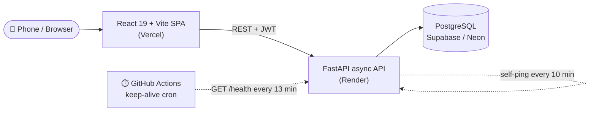
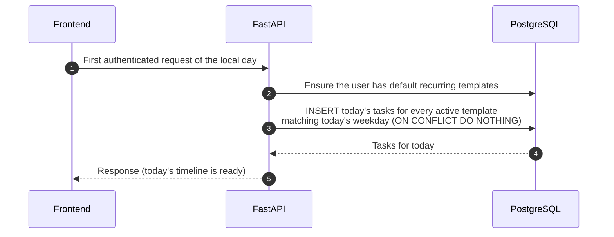

<div align="center">

# 🗓️ SheenAI

**A mobile-first daily routine & task tracker that builds your day for you — recurring routines, streaks and time analytics in one place.**

[](https://sheenai.vercel.app)


[Features](#-features) · [Architecture](#%EF%B8%8F-architecture) · [Tech Stack](#-tech-stack) · [Getting Started](#-getting-started) · [API](#-api-reference) · [Structure](#-project-structure)

</div>

---

## ✨ Features

| | Feature | What it does |
|---|---|---|
| 🔁 | **Auto-generated day** | Recurring templates (Gym, Office, Prayer, …) materialise into today's tasks on your first request of the day — idempotently, so nothing is ever duplicated. |
| ⚡ | **Quick add** | Add a one-off task in seconds from anywhere in the app. |
| 🧭 | **Timeline view** | See today's tasks on a time-ordered timeline, filter by date, category or status. |
| ✅ | **Status tracking** | Move tasks through `pending → in_progress → done` (or `missed`). |
| 🔥 | **Streaks** | Consecutive-day streaks per category, computed with pure SQL — no LLM, no guesswork. |
| 📊 | **Analytics dashboard** | Time breakdown by category and completion rate by day/week, rendered with Recharts (lazy-loaded). |
| 🔐 | **JWT auth** | Sign up / sign in with hashed passwords (bcrypt) and bearer tokens. |
| 📱 | **Mobile-first dark UI** | Bottom tab bar on phones, top nav on desktop, skeleton loaders and toast feedback everywhere. |
| 🌙 | **Always-on on free hosting** | In-process self-ping + a GitHub Actions cron keep the Render backend warm. |

## 🏗️ Architecture



<details>
<summary><b>🔁 How the daily routine is generated</b></summary>

<br/>



A unique constraint on `(user, date, template)` plus `ON CONFLICT DO NOTHING` makes generation safe even when several requests race each other.

</details>

## 🧰 Tech Stack

<table>
<tr><td><b>Frontend</b></td><td>React 19, TypeScript, Vite, Tailwind CSS v4, React Router 7, Recharts, Sonner (toasts), lucide-react, oxlint</td></tr>
<tr><td><b>Backend</b></td><td>FastAPI, async SQLAlchemy 2, asyncpg, Alembic, Pydantic v2 / pydantic-settings, python-jose (JWT), bcrypt</td></tr>
<tr><td><b>Database</b></td><td>PostgreSQL (Supabase or Neon)</td></tr>
<tr><td><b>Infra</b></td><td>Vercel (frontend), Render (backend), GitHub Actions (keep-alive cron)</td></tr>
</table>

## 🚀 Getting Started

### Prerequisites

- Python **3.12+** (requirements are pinned for 3.14 wheels)
- Node.js **20+**
- A PostgreSQL database (a free Supabase or Neon instance works)

<details open>
<summary><b>1️⃣ Backend</b></summary>

```bash
cd backend
python -m venv .venv
source .venv/bin/activate          # Windows: .venv\Scripts\activate
pip install -r requirements.txt

cp .env.example .env               # then set DATABASE_URL, SECRET_KEY, TIMEZONE...
alembic upgrade head               # create tables
python -m app.db.seed              # seed the 6 categories
uvicorn app.main:app --reload --port 8000
```

API docs are now live at **http://localhost:8000/docs**.

</details>

<details open>
<summary><b>2️⃣ Frontend</b></summary>

```bash
cd frontend
npm install
cp .env.example .env               # VITE_API_BASE_URL=http://localhost:8000
npm run dev                        # http://localhost:5173
```

</details>

<details>
<summary><b>🧪 Smoke test the whole flow</b></summary>

With the backend running:

```bash
cd backend
python scripts/smoke_test.py       # signup → login → categories → recurring → tasks → stats
```

It asserts every step and deletes its own test user (`--keep` to leave it, `--base-url` to point elsewhere). A copy-paste curl version lives in [`backend/scripts/curl_walkthrough.md`](backend/scripts/curl_walkthrough.md).

</details>

<details>
<summary><b>⚙️ Environment variables</b></summary>

**`backend/.env`**

| Variable | Description |
|---|---|
| `DATABASE_URL` | Postgres connection string (`postgresql://…` is rewritten to `postgresql+asyncpg://`) |
| `SECRET_KEY` | JWT signing key — `python -c "import secrets; print(secrets.token_urlsafe(48))"` |
| `ACCESS_TOKEN_EXPIRE_MINUTES` | Token lifetime |
| `TIMEZONE` | IANA timezone that defines "today", e.g. `Asia/Kolkata` |
| `CORS_ORIGINS` | Comma-separated allowed origins |
| `ENVIRONMENT` | `development` / `production` |
| `KEEPALIVE_URL` *(optional)* | Override the self-ping target |
| `KEEPALIVE_INTERVAL_SECONDS` *(optional)* | Self-ping cadence (default `600`) |

**`frontend/.env`**

| Variable | Description |
|---|---|
| `VITE_API_BASE_URL` | Backend base URL, no trailing slash |

</details>

## 📡 API Reference

<details>
<summary><b>View all endpoints</b></summary>

| Method | Path | Purpose |
|---|---|---|
| `GET` | `/health` · `/health/db` | Liveness · database check |
| `POST` | `/auth/signup` | Create account → `{access_token, user}` |
| `POST` | `/auth/login` | Email + password → `{access_token, user}` |
| `GET` | `/auth/me` | Current user |
| `GET` | `/categories` | List the 6 categories |
| `GET` | `/tasks` | List tasks (`?date=`, `date_from`, `date_to`, `category_id`, `status`) |
| `GET` | `/tasks/{id}` | Single task |
| `POST` | `/tasks` | Create a manual task |
| `PATCH` | `/tasks/{id}` | Partial update, e.g. `{"status": "done"}` |
| `DELETE` | `/tasks/{id}` | Delete a task |
| `GET` / `POST` | `/recurring-templates` | List / create recurring templates |
| `GET` | `/stats` | Streaks + time breakdown + completion (`?date_from=&date_to=&granularity=day\|week`) |
| `GET` | `/stats/streaks` · `/stats/time-breakdown` · `/stats/completion` | Individual stats |

Full interactive docs: `/docs` (Swagger UI).

</details>

## 📁 Project Structure

<details>
<summary><b>Expand tree</b></summary>

```text
SheenAI/
├── .github/workflows/keepalive.yml   # cron that keeps the Render API awake
├── backend/
│   ├── app/
│   │   ├── api/routes/               # auth, tasks, recurring, categories, stats, health
│   │   ├── core/                     # config, async DB, security, keep-alive, time helpers
│   │   ├── models/                   # User, Category, RecurringTemplate, Task
│   │   ├── schemas/                  # Pydantic request/response models
│   │   ├── services/                 # recurring generation + stats (pure SQL)
│   │   ├── db/seed.py                # idempotent category seed
│   │   └── main.py
│   ├── alembic/                      # migrations
│   └── scripts/                      # smoke test + curl walkthrough
└── frontend/
    └── src/
        ├── auth/                     # AuthContext, route guards
        ├── components/               # Layout, QuickAdd, TaskTimeline, ui/ primitives
        ├── lib/                      # api client, formatting, theme, types
        └── pages/                    # Dashboard, TaskList, TaskForm, SignIn, SignUp
```

More detail: [`backend/README.md`](backend/README.md) · [`frontend/README.md`](frontend/README.md)

</details>

---

<div align="center">

Built by **[Shariq](https://github.com/Shariq2003)** · [LinkedIn](https://www.linkedin.com/in/shariq-sd)

⭐ If you like this project, consider giving it a star!

</div>
